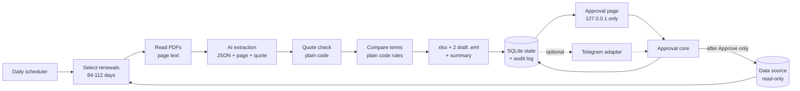

# Pre-Renewal Autopilot

A night-shift assistant for an insurance broker's renewals. Every morning it picks the commercial policies
that expire in 12 to 16 weeks, reads the expiring policy and the renewal offer, compares the terms in plain
code, and leaves a prepared pack on the desk: a comparison spreadsheet and two draft emails (one for the
client, one for the insurer). Then it asks the broker to approve. **It never sends anything itself.**

> **Concept project.** All data is synthetic (made up): invented clients, insurers and policy documents.
> It prepares **drafts only**; a person reviews and approves everything. It is not insurance advice.


## The problem

Before a commercial policy renews, a broker has to read the old policy and the new offer side by side, spot
what changed (premium, excess, cover limit, dates, exclusions), put it in a spreadsheet and write to the
client and the insurer. It is slow, repetitive and easy to miss a line, such as a new flood exclusion on page 4.

## How it works

1. **Select**: every policy expiring in 84 to 112 days (inclusive) is picked; others are skipped and logged.
2. **Read**: each PDF's text is extracted page by page. An AI model returns the key terms as JSON, each with a
   page number and a short quote. Plain code checks every quote and value against that page.
3. **Compare**: plain code (never the AI) computes every difference and its severity, using fixed rules.
4. **Build**: a comparison `.xlsx`, a client draft `.eml`, an insurer draft `.eml` and a summary.
5. **Ask**: a card with Approve / Open / Skip appears on a local web page (Telegram is an optional second channel).
6. **After Approve**: the drafts are saved to an "approved" folder and the renewal status is updated.
7. **Record**: every action is written to an audit log.



More detail and a sequence diagram of one morning run: [docs/ARCHITECTURE.md](docs/ARCHITECTURE.md).

## Safety design

- **Draft-only.** There is no email-sending code and no mail library in the project. A test scans the code
  and every production dependency for sending APIs.
- **A person approves everything.** Nothing counts until the broker clicks Approve (or runs `npm run approve`).
- **Audit log.** Every step (selection, extraction, comparison, pack written, card sent, approve, skip,
  refused attempts) is recorded with who did it.
- **Read-only data access.** The data source is read-only except one write: the renewal status, set to
  "approved" only by the approval core. Tests prove the fixtures are unchanged after a full flow.
- **Kill switch.** `npm run pause` stops all runs (a PAUSE file); `AUTOPILOT_ENABLED=false` does the same.
- **Dry run.** `npm run run -- --dry-run` shows what would happen and writes nothing at all.
- **Idempotency.** One pack per policy per renewal cycle; a rerun with unchanged inputs does nothing, and a
  changed input creates a new version, never a duplicate.
- **Prompt-injection handling.** Document text is treated as data between fixed delimiters; extracted text
  can never change a status, flag or severity (only the plain-code rules can). One test document contains
  "Ignore all previous instructions..." and is handled like a normal policy.
- **Uncertain facts are flagged, never guessed.** A value whose quote is not on its stated page drops to low
  confidence and becomes a "needs human check" flag instead of a computed difference.
- **Local-only approval page.** It binds to `127.0.0.1`, needs a token, and checks CSRF, Origin and Host on
  every action. See [docs/SECURITY.md](docs/SECURITY.md).

## Quick start

Prerequisites: Node.js `>=22`. Developed and tested on Windows only (Node `24.19.0`, npm `12.0.2`); the code
uses portable paths, but macOS and Linux have not been tested.
Commands are shown for PowerShell; on macOS or Linux use `cp` instead of `Copy-Item`.

```powershell
npm ci
Copy-Item .env.example .env
npm run fixtures:verify
npm run reset-demo
npm run run -- --fake-llm
npm run serve
```

- `npm ci` may warn that an install script (esbuild) was blocked; the tools still work.
- `.env.example` already sets `REFERENCE_DATE=2026-10-19`, the date the synthetic fixtures are built around.
- `--fake-llm` uses the answer keys instead of an AI model and prints a loud banner, so no API key is needed.
  To use a real model, set `LLM_PROVIDER=openai`, `LLM_API_KEY` and `LLM_MODEL` in `.env` (never commit it)
  and run `npm run run` without `--fake-llm`.
- `npm run serve` prints a link such as `http://127.0.0.1:8787/?t=...`. Open it once in a browser on the
  same computer. Stop with Ctrl+C.

Expected after `npm run run -- --fake-llm`: `new_pack=11 needs_attention=2 skipped_outside_window=1
skipped_already_processed=1`. For the demo data set (four policies and the throwaway token `demo-token`),
use `npm run demo:reset`.

## Using the approval page

- Each waiting pack is one card: client and policy type, weeks to renewal, overall risk, the top changes and
  how many items need your eye. Every card says "Draft only: nothing has been sent."
- **Open** downloads the comparison spreadsheet (nothing changes).
- **Approve** records your decision, copies the spreadsheet and both drafts to `output/approved/...` and sets
  the renewal status to approved. Nothing is emailed: open the `.eml` drafts in your mail app yourself.
- **Skip** records that you skipped this renewal for now.
- Policies that could not be compared (a missing or unreadable document) appear as notices without buttons.
- From a terminal instead: `npm run status`, then `npm run approve -- <packId>` or `npm run skip -- <packId>`.
  `npm run audit -- <policyId>` shows the full history of one policy.

## Optional: Telegram

The local page is the main channel. Telegram can be added as a second channel:

1. Create a bot with Telegram's BotFather and put its token in `.env` as `TELEGRAM_BOT_TOKEN`.
2. Put your numeric chat id in `TELEGRAM_ALLOWED_CHAT_IDS` (only these chats can approve).
3. Set `APPROVAL_CHANNELS=both`, run `npm run check:approval`, then `npm run serve`.

Honest note: the computer running the tool must be able to reach the Telegram Bot API. That may be blocked in
some countries or networks, and this adapter has not been tested against the real Telegram service.

## Configuration

Every setting lives in `.env` (copy `.env.example`). Secrets are only ever read from `.env`.

| Variable | Default | What it does |
| --- | --- | --- |
| `LLM_PROVIDER` | unset | AI provider; only `openai` is supported. Needed only for real (non-fake) runs. |
| `LLM_API_KEY` | unset | Secret API key. Never logged, stored or committed. |
| `LLM_MODEL` | unset | Model name, e.g. a dated snapshot so results stay repeatable. |
| `LLM_TEMPERATURE` | unset | Sent only when set; some models reject it. |
| `RUN_LIVE_LLM` | `false` | Paid scripts (`extract:one`, `live:check`, `eval:live`, `demo:warm`) refuse to call the AI unless true. |
| `APPROVAL_CHANNELS` | `web` | `web`, `telegram` or `both`. |
| `APPROVAL_WEB_PORT` | `8787` | Port of the approval page on `127.0.0.1`. |
| `APPROVAL_WEB_TOKEN` | unset | Secret login token for the page; random at each `serve` start when unset. |
| `APPROVER_NAME` | `broker` | Shown as "Approved by ..." on decided cards. |
| `REMINDER_AFTER_HOURS` | `48` | First reminder for a pack still waiting. |
| `REMINDER_INTERVAL_HOURS` | `24` | Gap between reminders. |
| `TELEGRAM_BOT_TOKEN` | unset | Secret bot token; only when Telegram is configured. |
| `TELEGRAM_ALLOWED_CHAT_IDS` | empty | Comma-separated numeric chat ids allowed to act through Telegram. |
| `TIMEZONE` | `Pacific/Auckland` | Time zone for "today" and the schedule. |
| `RUN_TIME` | `07:00` | Daily run time (24-hour `HH:mm`). |
| `DB_PATH` | `runtime/autopilot.db` | SQLite state database. |
| `FIXTURES_DIR` | `fixtures` | Read-only synthetic data and documents. |
| `DATA_DIR` | `data` | Writable data: the status overlay and the PAUSE file. |
| `OUTPUT_DIR` | `output` | Packs, approved copies and the fallback outbox. |
| `WINDOW_MIN_DAYS` | `84` | Start of the renewal window, inclusive. |
| `WINDOW_MAX_DAYS` | `112` | End of the renewal window, inclusive. |
| `PREMIUM_MEDIUM_PCT` | `10` | Premium increase (percent) that makes a MEDIUM flag. |
| `PREMIUM_HIGH_PCT` | `25` | Premium increase (percent) that makes a HIGH flag. |
| `DRY_RUN` | `false` | Reserved safety switch (use `--dry-run` on `npm run run`). |
| `AUTOPILOT_ENABLED` | `true` | Kill switch: `false` blocks every run. |
| `REFERENCE_DATE` | unset (`2026-10-19` in `.env.example`) | Fixed "today" for the synthetic fixtures. |
| `USE_AI_SUMMARY` | `false` | Not used: the optional AI wording polish was deliberately not built. |
| `MAX_CONCURRENCY` | `2` | Policies processed at the same time (`1`-`16`). |
| `APPROVAL_PUBLIC_ORIGIN` | unset | Public `https://` address when the page sits behind a reverse proxy; browser POSTs must come from it. |
| `UPLOAD_MAX_MB` | `10` | Largest PDF accepted on the upload page (`1`-`50`). |
| `UPLOAD_MAX_PAGES` | `30` | Most pages read from one uploaded PDF (`1`-`200`). |
| `UPLOAD_DAILY_LIMIT` | `10` | Uploads analysed per day (`1`-`200`); protects the AI budget. |
| `UPLOAD_RETENTION_DAYS` | `7` | Days an uploaded file is kept before `uploads:purge` removes it. |
| `ANALYSIS_TIMEOUT_SECONDS` | `180` | Time limit for one upload analysis (`10`-`1800`). |
| `EXTRACT_REPAIR_PASS` | `true` | One extra targeted AI reading for facts the checks could not confirm. |
| `PUBLIC_DEMO` | `false` | Open demo: no sign-in link needed. Only for a synthetic-data demo, never for real clients. |

## Evaluation

Measured with a real model on the synthetic set, three repeats; full report with every table:
[reports/eval-2026-10-20-live.md](reports/eval-2026-10-20-live.md). **All data is synthetic, and the
fixtures were written by the project author from templates: these numbers measure this set only, not
real-world policy documents.** The lines below are generated by `npm run results:summary`.

<!-- results:start -->
1. Field values exact: 672 of 672 (100.00%). 8 schedule fields per document, 28 synthetic documents x 3 repeats, model gpt-5.4-nano-2026-03-17, prompt v1; exact match with the answer keys after normalising numbers, dates and text.
2. Source page correct: 672 of 672 (100.00%). Stated page equals the answer-key page, same facts.
3. Quote check passed: 672 of 672 (100.00%). Facts from successful reads with no quote warning (the quote and value were found on the stated page, in plain code).
4. Wrong value still at high confidence: 0 of 672 facts. The dangerous case; each one is listed in the report.
5. Exclusions: recall 312 of 312 (100.00%), precision 312 of 312 (100.00%). Exclusion keys per document compared as sets with the answer keys.
6. Differences found, end to end: 30 of 30 (100.00%). Answer-key differences produced by PDF -> extraction -> plain-code comparison; a match needs field, change and severity.
7. Differences that were real: 30 of 30 (100.00%). Differences produced that are in the answer keys.
8. Final status correct: 45 of 45 (100.00%). 15 scenarios x 3 repeats through the real pipeline (selection, missing and unreadable documents included).
9. Run-to-run spread, field values: repeat 1: 224 of 224; repeat 2: 224 of 224; repeat 3: 224 of 224. The same documents read 3 times.
10. Cost and time: 0.0696 USD for all 84 calls; mean 4113.3 ms per document. From reported tokens and the author-typed price; times on one machine and network.
<!-- results:end -->

What this does not show: how it reads real documents (other layouts, scans, long or multi-schedule
policies), or a statistically meaningful error rate. See the "does NOT prove" section of the report.

## Limits

Read [docs/LIMITS.md](docs/LIMITS.md): no OCR, three policy types, English only, one template family in the
evaluation, one brokerage, a page that works only on this computer, Telegram unverified, no email sending
by design, no insurance advice, and what real use would need.

## Project structure

```text
src/
  domain/      types, schemas, dates, errors, text hygiene
  config/      environment and logger
  data/        data source interface (read-only + one status write)
  selection/   renewal window and grouping
  documents/   PDF text, extraction prompt, quote checks, cache
  llm/         AI client (JSON + validation retries) and a fake for tests
  compare/     plain-code comparison rules, wording
  outputs/     spreadsheet and draft emails (no sending)
  state/       SQLite, migrations, audit log, locks
  pipeline/    the daily run, scheduler, kill switch, demo reset
  approval/    approval core, web page, optional Telegram adapter
  cli/         command line
scripts/       fixtures, evaluation, demo, number checks
fixtures/      synthetic data, PDFs and answer keys
templates/     comparison spreadsheet template
test/          unit, failure-injection and security tests
docs/          decisions, architecture, security, limits, demo script, case study
reports/       evaluation reports (only the final live report is committed)
```

## Testing

| Command | What it runs |
| --- | --- |
| `npm test` | every test (no network, no API key) |
| `npm run test:failure` | failure injection: bad AI output, timeouts, damaged PDFs, a locked database, an unwritable folder |
| `npm run test:security` | prompt injection, the attack-surface matrix, no-send scan, secrets, read-only data, refused approvals, web page |
| `npm run typecheck` | TypeScript strict check |
| `npm run lint` | Biome lint |
| `npm run fixtures:verify` | checks every fixture file and PDF |
| `npm run eval:fake` | plumbing check with the answer keys (does not measure accuracy) |
| `npm run eval:live` | real-model evaluation: prints the call count and stops unless confirmed |
| `npm run docs:check-numbers` | lists any number in the docs not found in the evaluation report |

## License

[MIT](LICENSE)

## Credits

Built by Muhammad Ahmad Tahir as a portfolio concept, with help from Claude Code. Libraries: Zod, ExcelJS,
pdf.js (`pdfjs-dist`), pdf-lib, the OpenAI Node SDK, grammY, Vitest, tsx and Biome. Node's built-in SQLite
module stores the state.
