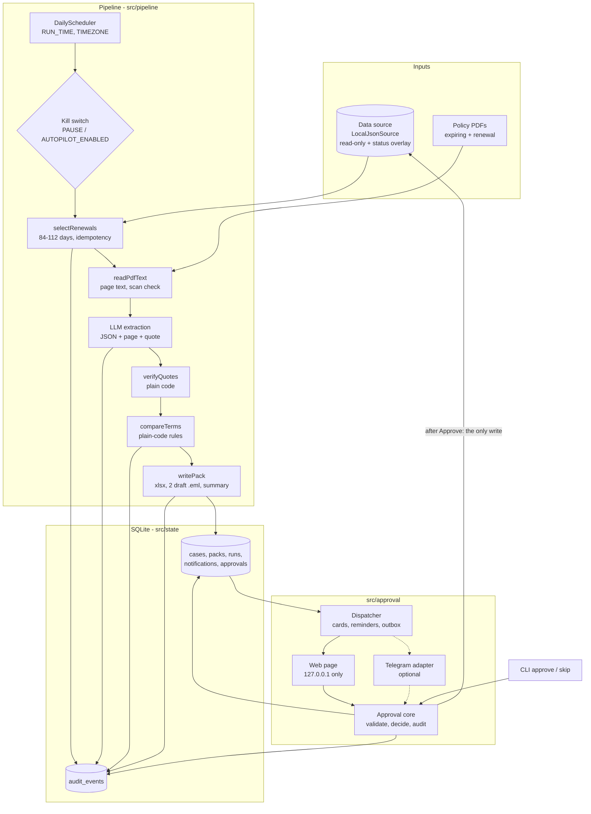
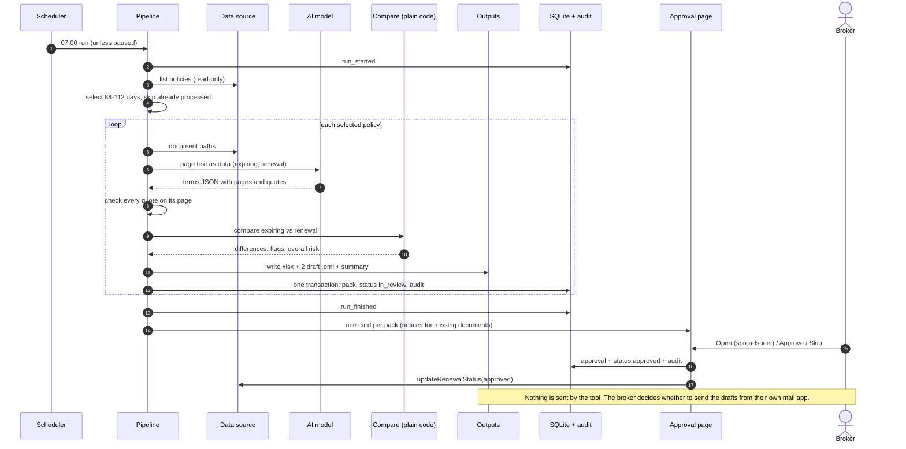

# Architecture

Concept project, synthetic data only, drafts only. One Node.js process (`npm run serve`) holds the daily
scheduler, the local approval page and (optionally) the Telegram adapter. Everything else is plain modules
under `src/`, each with one job (see the README in each folder).

## Components

Key boundaries:
- The AI model only turns page text into JSON. It never compares, grades or decides.
- `src/compare` is pure code with no I/O; the same input always gives the same differences and flags.
- `src/outputs` writes files only. There is no sending code anywhere.
- `updateRenewalStatus` is called only by the approval core, only with "approved".
- Each policy is processed on its own: one failure marks that policy "needs attention" and the run continues.

## One morning run

## Rendering the diagrams to images

- GitHub and many Markdown viewers render `mermaid` code blocks directly.
- To export a PNG or SVG: paste a diagram into the Mermaid Live Editor (mermaid.live) and use its export
  button, or use the Mermaid command-line tool (`@mermaid-js/mermaid-cli`, command `mmdc`). Check the
  current Mermaid docs for the exact install and export commands.
- Not verified here: I did not render these diagrams to images in this environment. The syntax follows
  Mermaid's flowchart and sequence diagram forms; check them once in the Live Editor before publishing.
