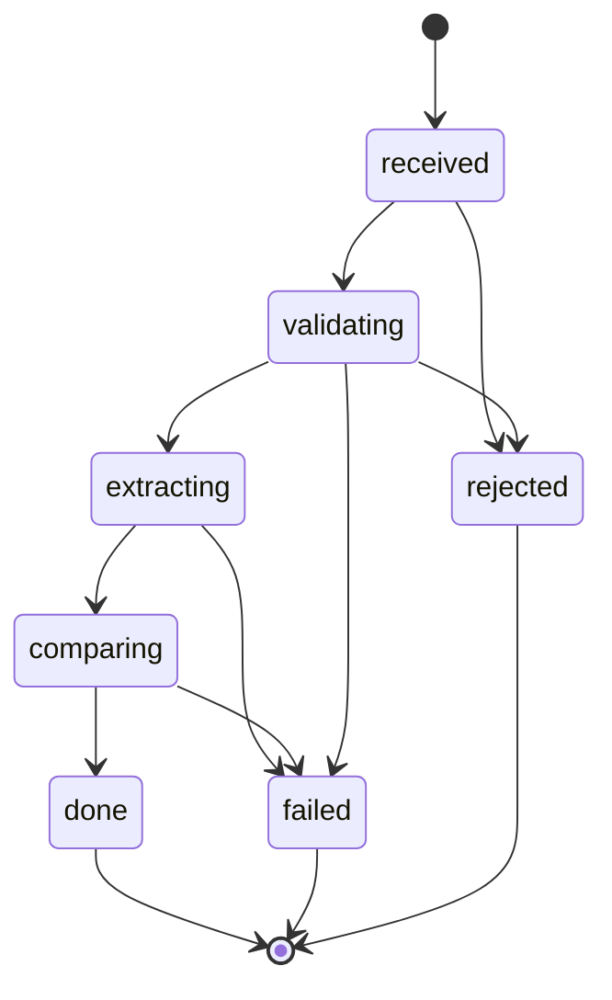

# UPLOADS - manual upload, manual analysis and overview spreadsheets (Prompt 7, D-F)

Status: built in Prompt 7 (stages U1-U4, 2026-10-21), not yet committed. Synthetic documents only. Section 1 records the code AS IT WAS before Prompt 7; the later sections describe what was built.

## 1. Current state (facts read from the code on 2026-10-21, before Prompt 7 changes)

Gate results: `npm run typecheck` clean; `npm test` 16 files / 257 tests passed (after Prompt 6 + the
APPROVAL_PUBLIC_ORIGIN deployment change); `fixtures:hash -- --check` OK (combined
65bfa9e1b80d7718dbcc890a31e2aafe294162ff16b933ad9de0ceb18cb81ecf matches the snapshot). `fixtures:verify` in this
git worktree reports 56 warnings (pdfjs cannot find its standard fonts because node_modules lives in the main
checkout; `pdfText.ts` builds the font path from `process.cwd()`); run from the main checkout it reports
"1281 checks passed, 0 failures, 0 warnings". Environment artefact, not a fixture problem.

### Per-candidate body of runPipeline (src/pipeline/runPipeline.ts `processPolicy`)
1. `getCaseByCycleKey(db, cycleKey)`.
2. Documents come from the DATA SOURCE: `dataSource.getDocumentPaths(policyId)` (LocalJsonSource:
   `<FIXTURES_DIR>/documents/<policyId>/{expiring,renewal}.pdf`, only files that exist). Audit `documents_checked`.
3. Idempotency: `computeInputHash` = sha256 of {sha256 of each file or "missing", EXTRACT_PROMPT_VERSION,
   reader.modelName, COMPARE_RULES_VERSION, premium thresholds, TEMPLATE_VERSION}. Same hash and not forced ->
   audit `unchanged_skip`, outcome unchanged_skip. Approved/skipped and not forced -> skipped_already_processed.
4. A missing side throws `DocumentMissingError` -> `failed()`.
5. `reader.read(path, {policyId, kind})` for both sides (audit `terms_extracted` x2, token counts).
6. `compareTerms` -> `buildSummary` -> audit `comparison_done`.
7. `getClient` / `getBroker`; version = currentVersion + 1; `writePack(... allowOverwrite: true)` -> audit `pack_written`.
8. `commitPack` = ONE transaction: supersede old active pack (audit `pack_superseded`), `insertPack`,
   `updateCaseFields`, transitions: approved/skipped -(forced)-> drafted; not_started/needs_attention -> drafted;
   drafted -> in_review (each audits `status_changed`).
9. `failed(error)`: if an active pack exists -> audit `policy_failed`, outcome failed_kept_previous, nothing else
   changes. Otherwise -> case created or moved to needs_attention, `attention_reason` set, input hash stored only for
   deterministic causes (missing / unreadable document), audit `needs_attention`, a notice queued.

### Exact signatures used by Prompt 7
```ts
readPolicyTerms(pdfPath: string, deps: { llm: LlmClient; cache?: ExtractionCache; maxRetries?: number;
  policyId?: string; documentKind?: 'expiring' | 'renewal' }): Promise<{ terms: ExtractedTerms;
  warnings: ExtractionWarning[]; usage: LlmUsage; fromCache: boolean }>
compareTerms(expiring: ExtractedTerms, renewal: ExtractedTerms, config: CompareConfig): { diffs; flags; overallRisk }
buildSummary(diffs: readonly TermDiff[]): { headline: string[]; details: string[] }
writePack(input: WritePackInput): Promise<{ paths: PackPaths; contentHash: string; written: boolean }>
// "buildXlsx" is a module, not a function: buildWorkbookModel(input: XlsxInput): WorkbookModel and
// renderWorkbook(model, templatePath, runDate): Promise<Buffer>; workbookModelText(model) feeds the contentHash.
handleAction: (request: { action: 'approve'|'open'|'skip'; packId: number; actor: AuditActor;
  channel: 'web'|'telegram'|'cli' }) => Promise<ActionResult>
canTransition(from, to, { force? }): boolean; assertTransition(policyId, from, to, { force? }): void
  // ALLOWED: not_started->drafted|needs_attention; needs_attention->drafted; drafted->in_review;
  //          in_review->approved|skipped. FORCED: approved|skipped->drafted.
recordAudit(input: { type; runId?; policyId?; cycleKey?; actor; details? }): number   // guarded details
onPacksReady(packs: NewPackInfo[], notices: NoticeCaseInfo[]): Promise<void>          // Dispatcher
interface Notifier { channel; start(handler); stop(); sendPack(card); sendNotice(card); markResolved(ref, text); sendReminder(card) }
```

### Extraction cache
Key = `${fileSha256}|${EXTRACT_PROMPT_VERSION}|${model}`; one JSON file per key, file name = sha256(key) + `.json`
under `.cache/extractions/`. Every entry stores `fileSha256`, so entries for a document hash CAN be found (scan
the folder, parse, match `fileSha256`) and deleted. Entries hold verified terms, warnings and usage, never text.

### Run lock
`acquireLock(<DATA_DIR>/runtime/run.lock)`: a PID file created with `wx`; a lock whose PID is gone is stale and
taken over (LockHeldError otherwise). `serve` also holds `serve.lock`. The scheduler takes run.lock per run.

### Web server
Body: `readBody` streams and stops at MAX_BODY = 4096 bytes (413 page). CSP (current, byte-for-byte):
`default-src 'none'; style-src 'self'; font-src 'self'; img-src 'none'; form-action 'self'; frame-ancestors 'none'; base-uri 'none'`.
Host check first, then `/assets/*`, then `/?t=` sign-in, then the session cookie, then routes. POST needs Origin
+ CSRF. Bound to 127.0.0.1; APPROVAL_PUBLIC_ORIGIN (Prompt 6 deployment) adds exactly one extra HTTPS host/origin.

### Migrations
`migrate(db, clock)` applies `src/state/migrations/NNN_name.sql` in order, each in its own transaction, recorded
in `schema_migrations`. Latest: `001_initial`.

### Cards and notices on the web page
`src/approval/web/views.ts`: `renderListPage` -> waiting rows (`waitingRow`, Approve/Open/Skip forms), decided
rows, needs-attention rows (`noticeRow`: client, policy type, `attentionSentence(reason)`, "No comparison was
prepared...", NO buttons). Client and policy come from `dataSource.getPolicy/getClient`.

### pol-s07 and pol-s08 today
pol-s07: no `renewal.pdf` -> `DocumentMissingError('renewal')` -> needs_attention, reason
`renewal document missing`, input hash stored (deterministic) so later runs are `unchanged_skip`; one notice per
channel. pol-s08: image-only expiring PDF -> `DocumentUnreadableError` -> needs_attention, reason
`document has no readable text (image-only scan)`. Neither can be fixed today: the data source is read-only.

## 2. Domain model

| Noun | What it is | Stored in |
| ---- | ---------- | --------- |
| UploadJob | one analysis request (one or two PDFs) | `uploads` |
| StoredDocument | one uploaded PDF (side, sha256, size, pages, safe display name, stored path) | `uploaded_documents` |
| ManualClient | a client typed in by the broker for a NEW policy | `manual_clients` |
| ManualPolicy | a policy that exists only because of an upload (`man-` id) | `manual_policies` |
| ExportRecord | one overview spreadsheet | `exports` |
| Case (existing) | + `origin`: `data_source` \| `manual` | `cases.origin` |
| Pack (existing) | + `inputSource`: `data_source` \| `upload` | `packs.input_source` |

Modes: `attach` (add a document to an existing data-source policy; the other side comes from the data source when
not uploaded) and `new` (a policy that does not exist yet; both documents required).

### UploadJob states

Allowed transitions (`UPLOAD_TRANSITIONS`, tested like the status machine): received -> validating | rejected |
failed; validating -> extracting | rejected | failed; extracting -> comparing | failed; comparing -> done | failed.
done, failed and rejected are terminal. `rejected` = refused at the door with a typed reason (consent, limits, file
checks, unknown policy, fake-mode unknown document). `failed` = something broke later (identity checks U-2,
unreadable AI output, timeout, interrupted). Running states: validating, extracting, comparing.

### Rules
- **U-1 Uploads never write to the data source.** The only data-source write stays `updateRenewalStatus` on
  Approve, and only for cases with origin `data_source`. Manual-origin approvals are recorded in the database
  only; the audit says `data source not applicable (manual case)`.
- **U-2 Fail closed.** If insurerName, policyNumber (expiring), periodEnd (expiring) or policyType is not read with
  confidence high or medium AND a verified quote (no verification warning on that field), or policyType is not one
  of the three in-scope types, or the two documents disagree on policyType, or (attach) the documents do not match
  the policy record (type, insurer, expiry), then NO pack is created: the job ends `failed` with a plain reason and
  the case (if any) is set or kept needs_attention. Never guess an identity.
- **U-3 Manual cases ignore the 84-112 day window.** Wording: `renews in N weeks (date)` (whole weeks rounded
  down), `renews today`, `expired N days ago`.
- **U-4 The nightly run never overrides a manual upload.** A case whose current pack has inputSource `upload` is
  left alone (audit `unchanged_skip`, reason `manual_override_in_place`) unless `--force --only <id>`.
- **U-5 Identity.** Attach: the existing policy id and cycleKey. New: `policyId = 'man-' + first 12 hex of
  sha256(normalised insurerName + '|' + normalised policyNumber)` from the EXPIRING document (lowercase, trimmed,
  collapsed whitespace); expiryDate = expiring periodEnd. Same pair again = unchanged_skip; a corrected renewal =
  version + 1 superseding version 1.
- **U-6 Uploaded text is hostile.** Same extraction hardening; escaped everywhere; never reaches a path, header,
  cell formula, markup or log unguarded.
- **U-7 Synthetic documents only.** The upload page requires the tick "These documents are made-up. Their
  contents are sent to the AI provider." The feature cannot technically prove a document is synthetic (LIMITS).

## Intake (Stage U2) - src/uploads/intake.ts

Per file, in this order (the first failure wins; the job ends `rejected` with the code and the side):
1. size: more than UPLOAD_MAX_MB -> `too_large` (checked before any parsing);
2. magic bytes: the first five bytes must be `%PDF-` -> else `not_a_pdf` (the declared content type and the file
   extension are never read; a real PDF named `schedule.docx` is accepted, a text file named `x.pdf` is not);
3. pdf.js opens it (time limit: a third of ANALYSIS_TIMEOUT_SECONDS, at most 30 s):
   `PasswordException` -> `encrypted`, any other open error or a time-out -> `corrupted`;
4. page count over UPLOAD_MAX_PAGES -> `too_many_pages` (counted before any page text is read);
5. text of every page; no page with at least 20 non-space characters -> `empty_or_scanned` (no OCR);
6. sha256 of the bytes.

VERIFIED by running pdfjs-dist 6.4.299 (not from memory): a PDF with a Standard security handler and no password
throws `PasswordException` (code 1, "No password given"); garbage after `%PDF-` and a truncated file throw
`InvalidPDFException` ("Invalid PDF structure."). The encrypted test PDF is hand-built (an /Encrypt dictionary;
pdf-lib cannot encrypt) and is refused as `encrypted` in test/uploadsIntake.test.ts.

Storage: `DATA_DIR/runtime/uploads/<32 hex from crypto.randomBytes(16)>/<side>.pdf`. The path is built ONLY from the
random id and the side; `resolveStoredPath` accepts nothing but that exact shape. Written to a temp name in the same
folder, then renamed. Folder mode 0700, file mode 0600: on Windows Node ignores these modes (NTFS permissions are
inherited from DATA_DIR); this could not be tightened here and is listed for Prompt 5's LIMITS. The client filename
is reduced to a display name: path parts, control, format (bidi) and line-break characters removed, spaces collapsed,
at most 100 characters; `..\..\x.pdf` shows as `x.pdf`, `CON.pdf` stays a harmless display string. Uploaded PDFs are
never served back to a browser (there is no route for them).

## Run safety (D-096, D-102, D-103)

- One analysis at a time and never during a pipeline run: uploads take the SAME run lock as `run` and the scheduler,
  through the run gate (src/state/runGate.ts), which also refuses a second holder inside the same process. A request
  that finds it held is refused `busy` immediately.
- A scheduled run inside `serve` that meets an analysis waits up to ANALYSIS_TIMEOUT_SECONDS + 30 s, then runs (or is
  skipped and audited `run_skipped_overlap`).
- Time-out: the job fails `timed_out`; the AI call cannot be cancelled, its late result is discarded and the gate stays
  closed until it settles.
- Startup: jobs left running by a stopped process are marked failed `interrupted` and audited.

## Live vs fake (D-100)

- Live: the same `createLlmReader` + JSON extraction cache as the nightly run (a re-upload of the same bytes is a cache
  hit, 0 new tokens). Without LLM_PROVIDER / LLM_API_KEY / LLM_MODEL the job is refused `ai_not_configured`; the CLI
  names the missing variables (never values).
- Fake (`--fake-llm`): ONLY documents in the known-document registry (sha256 of the bytes -> answer key; 28 fixture
  documents + 5 samples). Anything else is refused `unknown_in_fake_mode`. The registry is read-only, returns copies,
  and is never built in live mode.

## Samples - samples/uploads/ (D-107)

| File | What it is | Expected result |
| ---- | ---------- | --------------- |
| pol-s07-renewal.pdf | the renewal the nightly run reports as missing for pol-s07 | attach to pol-s07: pack v1, no changes, in_review |
| harbourview-expiring.pdf + harbourview-renewal.pdf | NEW invented client Harbourview Bakery Ltd, public liability, renews 2026-12-03 | new mode: manual case, 3 changes: cover limit decrease (high), asbestos exclusion added (high), premium +6.25% (low) |
| hostile-expiring.pdf + hostile-renewal.pdf | instruction sentence, extraction delimiter, `=HYPERLINK(...)` exclusion title, a 10,000-character paragraph; control and RTL characters in the answer keys | new mode: a pack whose flags come only from the compare rules (premium +30% high, added 'other' exclusion); everything shown escaped |
| scanned-expiring.pdf | image-only (no text layer) | refused `empty_or_scanned` |
| not-a-pdf.pdf | a text file with a .pdf name | refused `not_a_pdf` |

Every `*.truth.json` is validated with the Zod schemas and carries the sha256 of its PDF; `samples.sha256` lists all
files. `npm run samples:make` regenerates them byte for byte.

## CLI (thin consumer of the same service functions the web page will use)

```
npm run analyse -- samples/uploads/pol-s07-renewal.pdf --policy pol-s07 --confirm-synthetic --fake-llm
npm run analyse -- samples/uploads/harbourview-expiring.pdf samples/uploads/harbourview-renewal.pdf --new --client "Harbourview Bakery Ltd" --broker brk-01 --confirm-synthetic --fake-llm
npm run uploads:list
npm run uploads:delete -- <uploadId>
npm run uploads:purge -- --dry-run
```
`uploads:delete` removes the stored PDFs and the extraction-cache entries for those bytes (every cache entry stores
`fileSha256`), unless another live upload or a data-source document has the same bytes; audit rows, pack metadata
and the pack's drafts stay.

## Web pages (Stage U3)

| Route | What | Security |
| ----- | ---- | -------- |
| GET /analysis/new[?policy=<id>] | upload page; `policy` only preselects an existing option | session; GET changes nothing |
| POST /analysis | multipart upload -> 303 /analysis/<id>, or the upload page again with 400/413/415/429 | Host, session, Origin before the body; CSRF first part; limits (D-111) |
| GET /analysis/<id> | job page: progress, result, extracted facts, documents, AI usage, activity | session; meta refresh while running only |
| POST /analysis/<id>/delete | delete the stored PDFs (pack, drafts and audit kept) | session, Origin, CSRF (urlencoded, 4 KB body cap) |

- Every /analysis route is refused through APPROVAL_PUBLIC_ORIGIN (D-109) and answers 404 when uploads are not
  enabled (plain WebApprovalServer use, as in the Prompt 4/6 tests).
- Typed rejections map to: too_large 413, not_a_pdf 415, daily_limit_reached and busy 429, everything else 400.
  CSRF, Origin, Host and session failures are a bare designed 403 plus an `unauthorised_attempt` audit with the reason
  only.
- Uploaded PDFs are never served: there is no route that reads them (tested against likely paths; no response
  contains `%PDF-`).
- The CSP header is unchanged (byte-identical, asserted on the new pages).
- Meta refresh verified in a real browser (D-112).

## Spreadsheets (Stage U4)

**Per-analysis comparison workbook**: every uploaded pack is written by the same writePack/buildXlsx code and template
as the nightly run. The Summary sheet gets ONE extra row `Source | Uploaded manually`, only when the pack came from an
upload (`WritePackInput.uploaded`). Old hashes stay identical because nightly packs never get the row: their workbook
model, and so the canonical text the content hash is computed from, is unchanged (the existing hash tests pass
unchanged, and a test checks the model with `uploaded: false` equals the model without the flag).

**Overview spreadsheet** (`createOverview`, src/outputs/overview.ts + buildOverviewXlsx.ts):
- Sheets: Overview (policy, client, type, insurer, expiry date, weeks to renewal in the U-3 wording, overall risk
  word, number of flags, top change = the pack's first stored diff sentence, status, source 'Nightly run' /
  'Uploaded manually', pack version), Flags (every medium/high flag with policy and client), Notes (run date,
  filters, 'Drafts only. Nothing has been sent.', 'Synthetic data only', how to read severity).
- Filters: statuses (default In review + Approved; also Skipped, Needs attention), include manual cases yes/no.
  "Manual" = case origin 'manual' OR current pack from an upload. Sorted by expiry date, then policy id. Cases with no
  pack (needs attention, imported approvals) are listed with risk '(no pack)'.
- Cap: 500 rows, then a visible last row "Only the first 500 of N cases are listed..." and a Notes line.
- Same fonts, severity word AND colour, frozen header row, print setup (A4 landscape, one page wide, header row
  repeated). Every string goes through the same injection guard as the comparison workbook; no formulas are written.
- Deterministic: the run date is an input; the content hash is over the canonical model text; stored at
  `output/overview/<run date>/<first 12 hex>/overview.xlsx` (temp name, then rename); recorded in `exports`; the
  same content again is a no-op returning the same record (still audited, `created: false`).
- Download: `GET /exports/<id>/download` reads the relative path from the database by id and refuses anything that is
  not exactly `overview/<date>/<12 hex>/overview.xlsx` inside OUTPUT_DIR. Nothing in the request is a path.
- CLI: `npm run overview -- [--status in_review,approved] [--no-manual]` prints the file path.

## Security notes

Hostile text (U-6): the attack-surface matrix (test/security/uploads.test.ts) pushes 7 hostile inputs (formula
starter, `<script>`, CRLF header injection, markup, 10,000 characters, control + right-to-left characters, a path
traversal name) through 16 sinks as client name, contact name, filenames, an extracted exclusion title and summary,
and an extracted quote. Result on 2026-10-21: all 112 cells PASS (printed by the test). It found two real gaps that
were fixed (D-110, D-114): raw control characters in HTML, and bidi controls in plain-text outputs and cells.

Resource limits (what is limited):
- Request: Host, cookie and Origin before any byte is read; declared size over 2 x UPLOAD_MAX_MB + 64 KB refused
  unread; streamed size counted and cut off; busboy limits on parts (10), files (2), fields (8), field size (1000
  bytes), field-name size (40), header pairs (8); one in-flight upload per session.
- File: UPLOAD_MAX_MB per file before parsing; `%PDF-` magic; UPLOAD_MAX_PAGES checked before page text is read;
  a parse time limit (a third of ANALYSIS_TIMEOUT_SECONDS, at most 30 s).
- Work: one analysis at a time, never during a pipeline run (run gate); UPLOAD_DAILY_LIMIT analyses per local day;
  ANALYSIS_TIMEOUT_SECONDS per job.
- Storage: random 128-bit folder names; files only at uploads/<id>/<side>.pdf; never served back; deleted on request
  and after UPLOAD_RETENTION_DAYS (`uploads:purge`).

What could NOT be tested or guaranteed (for Prompt 5's LIMITS.md):
- PDF parser attacks: decompression bombs, deeply nested objects, malformed fonts or parser bugs in pdfjs-dist
  6.4.299. Parsing runs in the same Node process (pdf.js "fake worker"); the time limit stops WAITING for it, but a
  synchronous parse step cannot be interrupted, and memory use is bounded only by the file size limit.
- The AI call cannot be cancelled on time-out (D-102); its tokens may still be spent.
- The feature cannot prove a document is synthetic (U-7); the consent tick is a promise, not a check.
- File permissions on Windows: the 0700/0600 modes are ignored; NTFS permissions come from DATA_DIR.
- Browsers that receive a refusal before they finished sending a large body may show a connection error instead of
  the 413 page (Node test clients receive the page).
- Keyboard-only use, screen readers, Firefox and Safari were not checked by hand.
- busboy 1.6.0 was last published 2022-04-19 (npm audit: 0 vulnerabilities on 2026-10-21).

## Data retention and deletion

- Stored PDFs: DATA_DIR/runtime/uploads, kept UPLOAD_RETENTION_DAYS (default 7), then removed by
  `npm run uploads:purge` (there is no automatic timer in serve; run it yourself or schedule it). `uploads:delete
  <id>` and the job page's "Delete the uploaded PDFs" remove them at once.
- Deleting also removes the extraction-cache entries for those bytes, unless another live upload or a data-source
  document has the same bytes.
- Kept: the job row, the extracted facts shown on the job page (upload_terms), the pack and its drafts, approved
  copies, overview spreadsheets, and the audit trail (audit rows hold ids, codes, short hashes and counts only).

## What is NOT supported

OCR (scanned PDFs are refused), more than one PDF per side or batch uploads, editing extracted facts, real documents
(synthetic only), uploads through the public HTTPS origin, policy types other than commercial property, public
liability and business interruption, sending anything (drafts only), serving uploaded PDFs back to a browser.

## Environment variables (Prompt 7)

| Name | Default (range) | Used by |
| ---- | --------------- | ------- |
| UPLOAD_MAX_MB | 10 (1..50) | upload door, multipart limits |
| UPLOAD_MAX_PAGES | 30 (1..200) | upload door |
| UPLOAD_DAILY_LIMIT | 10 (1..200) | analyses started per local TIMEZONE day |
| UPLOAD_RETENTION_DAYS | 7 (1..365) | uploads:purge, the upload page |
| ANALYSIS_TIMEOUT_SECONDS | 180 (10..1800) | per job; a third of it (max 30 s) per PDF parse |

Live analysis also needs LLM_PROVIDER, LLM_API_KEY and LLM_MODEL (Prompt 2); without them the page says AI
reading is not configured. No new secrets.

## AI reading checks (enhancement, D-119 .. D-121)
The model only extracts. Every reading then goes through plain code: (1) each fact against the page it cites (quote
found, value in the quote, date in the quote), (2) the facts against each other (period order and length; premium and
excess smaller than the cover limit; positive amounts). Facts that fail get ONE targeted second reading (field names
and fixed reasons only); a second answer is accepted only if it passes every check. Whatever is still unconfirmed
stays as read, marked uncertain, and becomes a "needs your eye" item. The job page's Reading check panel shows the
counts. Switch: EXTRACT_REPAIR_PASS=true|false (default true).
